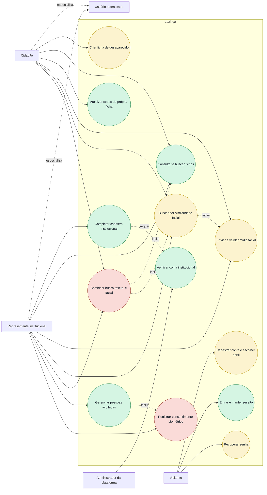

# Diagrama de casos de uso

O diagrama combina os casos exigidos pelos PDFs com o estado atual. A cor não
altera o requisito; apenas indica cobertura pela implementação existente.

## Legenda e rastreabilidade

| Caso de uso | Requisitos | Estado | Observação |
| --- | --- | --- | --- |
| Cadastrar conta e escolher perfil | RF-01 / US-01 | Parcial | Perfis existem; dados e aprovação institucional não. |
| Entrar e manter sessão | RF-02 | Implementado | Better Auth com sessão persistida. |
| Recuperar senha | RF-03 / US-02 | Parcial | Fluxo existe, mas o adapter atual registra e-mail no console. |
| Completar cadastro institucional | RF-01 / US-01 | Implementado | Representante cria e edita a instituição; dados legais alterados voltam a `PENDING`. |
| Verificar conta institucional | RF-01 / US-01 | Implementado | `PLATFORM_ADMIN` verifica, rejeita ou suspende. |
| Criar ficha de desaparecido | RF-10 | Parcial | Dados biográficos existem; fotografia vinculada à ficha ainda não. |
| Consultar e buscar fichas | RF-06 / RF-10 | Implementado parcialmente em relação ao RF-06 | CRUD de consulta existe; full-text tolerante a grafia não. |
| Atualizar status da própria ficha | RF-10 | Implementado | Apenas o autor pode alterar `ACTIVE`, `FOUND`, `ARCHIVED`. |
| Enviar e validar mídia facial | RF-04 / RF-05 / US-03 | Parcial | Formato/tamanho são validados; motor e PDF estão pendentes. |
| Buscar por similaridade facial | RF-07 / RF-08 / US-04 | Parcial | Detecção, embeddings e consulta multiângulo funcionam; cadastro de referências e enriquecimento dos candidatos ainda não. |
| Combinar busca textual e facial | RF-09 / US-05 | Pendente | Existem endpoints separados, não uma busca combinada. |
| Gerenciar pessoas acolhidas | RF-11 / US-06 | Implementado | CRUD restrito à instituição verificada, com arquivamento lógico e restauração. |
| Registrar consentimento biométrico | RNF-01 / US-06 | Pendente | Não existe entidade nem endpoint de consentimento. |

O ator `PLATFORM_ADMIN` verifica, rejeita e suspende instituições. A decisão
confirmada impede que ele opere acolhidos em nome de uma instituição.
