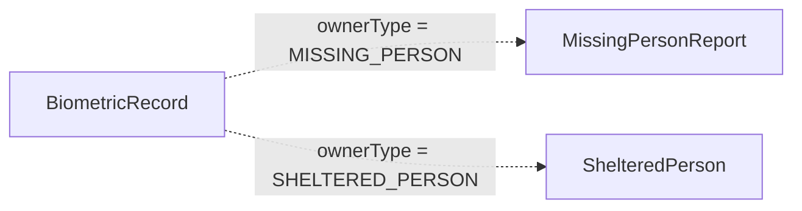

# Diagrama Entidade–Relacionamento

Este diagrama representa o **schema físico atual** de
`apps/api-ts/prisma/schema.prisma`. Ele não representa entidades apenas
propostas nos requisitos.

```mermaid
erDiagram
    User ||--o{ Session : "possui"
    User ||--o{ Account : "possui"
    User ||--o| Institution : "administra"
    User ||--o{ MissingPersonReport : "reporta"
    Institution ||--o{ ShelteredPerson : "acolhe"

    User {
        string id PK
        string name
        string email UK
        boolean emailVerified
        string image "nullable"
        UserRole role
        datetime createdAt
        datetime updatedAt
    }

    Session {
        string id PK
        datetime expiresAt
        string token UK
        datetime createdAt
        datetime updatedAt
        string ipAddress "nullable"
        string userAgent "nullable"
        string userId FK
    }

    Account {
        string id PK
        string accountId
        string providerId
        string userId FK
        string accessToken "nullable"
        string refreshToken "nullable"
        string idToken "nullable"
        datetime accessTokenExpiresAt "nullable"
        datetime refreshTokenExpiresAt "nullable"
        string scope "nullable"
        string password "nullable"
        datetime createdAt
        datetime updatedAt
    }

    Verification {
        string id PK
        string identifier
        string value
        datetime expiresAt
        datetime createdAt
        datetime updatedAt
    }

    MissingPersonReport {
        string id PK
        string reporterId FK
        string fullName
        int age "nullable"
        string birthPlace "nullable"
        string_array parentNames
        string lastSeenAddress "nullable"
        ReportStatus status
        datetime createdAt
        datetime updatedAt
    }

    Institution {
        string id PK
        string userId FK_UK
        string name
        string legalName "nullable"
        string document "nullable, unique"
        string address
        string contactPhone
        InstitutionStatus status
        datetime createdAt
        datetime updatedAt
    }

    ShelteredPerson {
        string id PK
        string institutionId FK
        string fullName
        string approxAge "nullable"
        string foundLocation "nullable"
        ShelterStatus status
        datetime createdAt
        datetime updatedAt
        datetime archivedAt "nullable"
    }

    BiometricRecord {
        string id PK
        BiometricOwnerType ownerType
        string ownerId "referência polimórfica sem FK"
        string imagePath
        vector_512 embedding "nullable"
        datetime createdAt
    }
```

## Relações físicas confirmadas

| Origem | Destino | Cardinalidade | Exclusão |
| --- | --- | --- | --- |
| `Session.userId` | `User.id` | N:1 | cascade |
| `Account.userId` | `User.id` | N:1 | cascade |
| `MissingPersonReport.reporterId` | `User.id` | N:1 | cascade |
| `Institution.userId` | `User.id` | 0..1:1 | cascade |
| `ShelteredPerson.institutionId` | `Institution.id` | N:1 | cascade |

`Verification` não possui foreign key para `User`; o Better Auth relaciona a
verificação pelo campo textual `identifier`.

## Referência biométrica polimórfica

O par `BiometricRecord.ownerType` + `ownerId` representa logicamente um dos
vínculos abaixo, mas **não há foreign key no banco**:



Consequências do schema atual:

- o banco não impede `ownerId` inexistente;
- a exclusão do proprietário não remove automaticamente o registro biométrico;
- a aplicação futura deverá manter essa integridade ou o modelo deverá ser revisto por migration.

## Enumerações

| Enum | Valores |
| --- | --- |
| `UserRole` | `CITIZEN`, `INSTITUTION_ADMIN`, `PLATFORM_ADMIN` |
| `InstitutionStatus` | `PENDING`, `VERIFIED`, `SUSPENDED`, `REJECTED` |
| `ReportStatus` | `ACTIVE`, `FOUND`, `ARCHIVED` |
| `ShelterStatus` | `UNCLAIMED`, `IDENTIFIED`, `REUNITED` |
| `BiometricOwnerType` | `MISSING_PERSON`, `SHELTERED_PERSON` |

## Índices relevantes

- HNSW em `BiometricRecord.embedding` com `vector_cosine_ops`;
- GIN trigram em `MissingPersonReport.fullName`;
- índices convencionais em status, responsáveis e identificadores descritos na migration.
