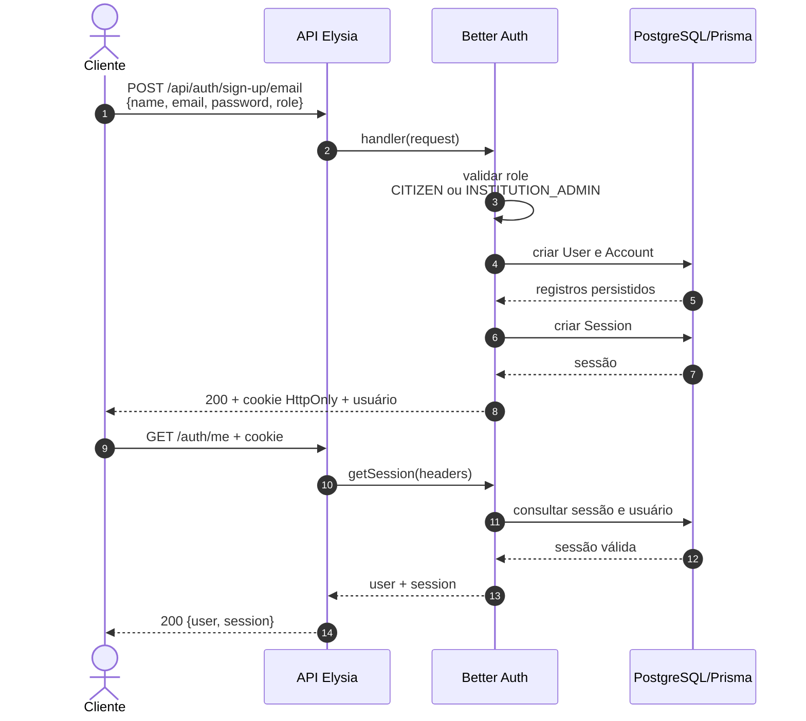
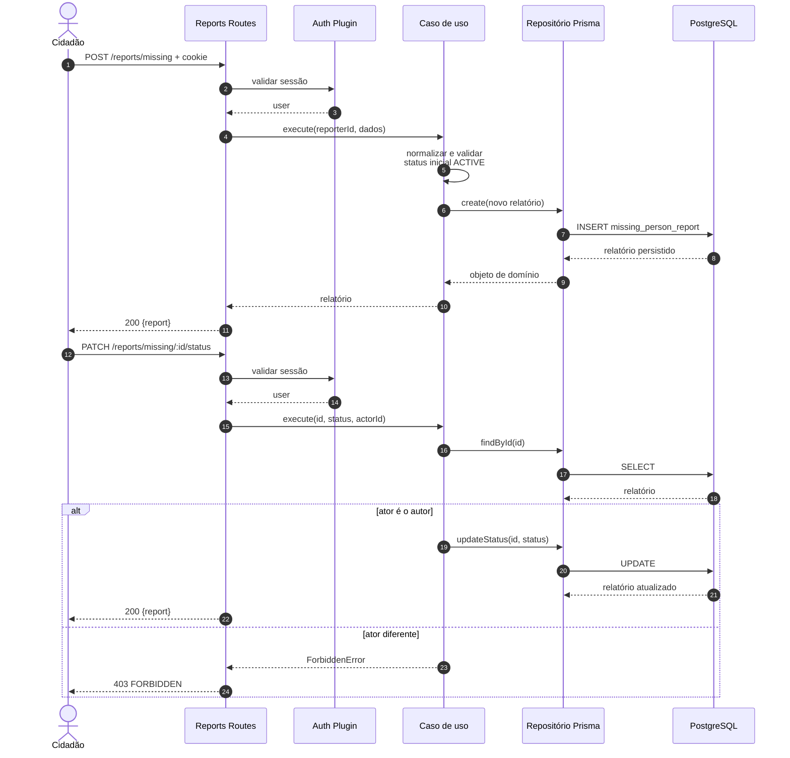
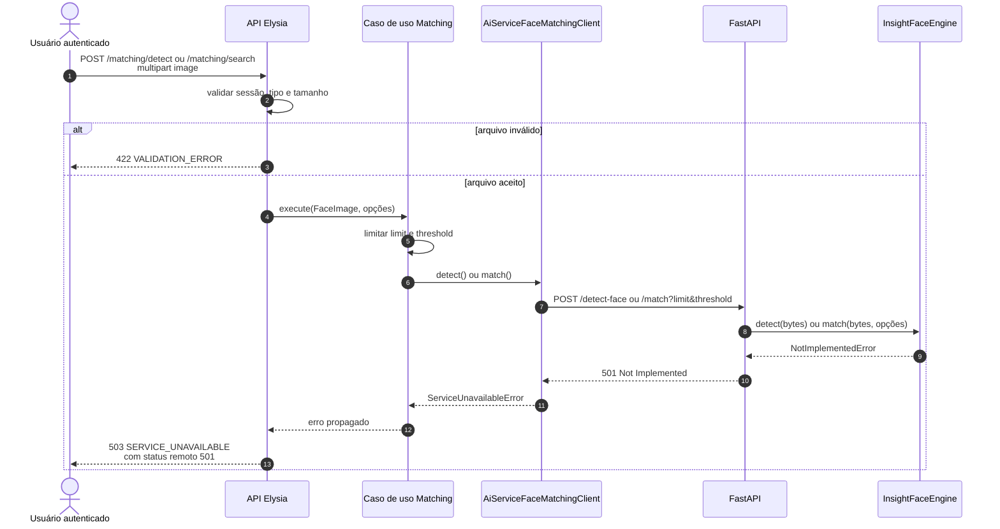
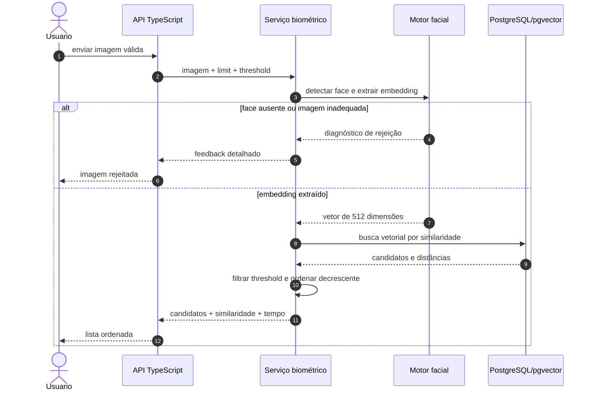
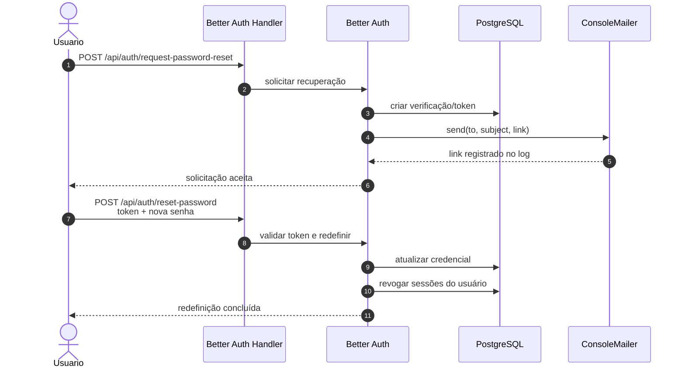

# Diagramas de sequência

Os diagramas abaixo separam fluxos atuais de fluxos-alvo. Respostas e componentes
pendentes são identificados explicitamente.

## 1. Cadastro e sessão — fluxo atual



O fluxo atual aceita o valor `INSTITUTION_ADMIN`, mas não cria automaticamente
uma linha em `Institution` nem executa verificação administrativa.

## 2. Criação e atualização de relatório — fluxo atual



## 3. Busca textual — fluxo atual

```mermaid
sequenceDiagram
    autonumber
    actor Usuario as Usuário autenticado
    participant API as Reports Routes
    participant UC as ListMissingPersonReports
    participant Repo as Repositório Prisma
    participant DB as PostgreSQL

    Usuario->>API: GET /reports/missing?q=...&status=...&limit=...&offset=...
    API->>UC: execute(query, status, limit, offset)
    UC->>UC: trim query<br/>limitar página a 1..100
    UC->>Repo: search(filtros)
    Repo->>DB: SELECT + COUNT em transação
    Note over Repo,DB: contains case-insensitive em campos escalares;<br/>has exato no array parentNames
    DB-->>Repo: registros + total
    Repo-->>UC: itens paginados
    UC-->>API: resultado
    API-->>Usuario: 200 {items, total, limit, offset}
```

Esse fluxo ainda não implementa toda a busca avançada do RF-06: idade/faixa
etária e tolerância geral a variações de grafia permanecem pendentes.

## 4. Detecção e matching — integração atual



## 5. Matching — fluxo-alvo dos requisitos

Este fluxo representa RF-05, RF-07 e RF-08 e **ainda não está implementado**.



## 6. Recuperação de senha — fluxo atual e limite operacional



O fluxo lógico existe, mas `ConsoleMailer` não entrega mensagens reais. A
duração exata de 30 minutos citada na US-02 não está configurada explicitamente
no código do projeto.
